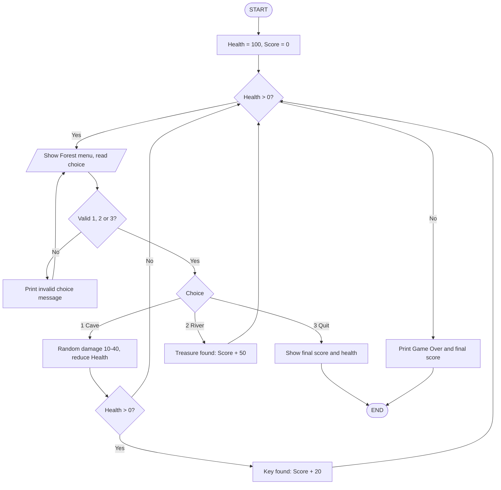

# Text-Based Adventure Game

[](https://github.com/shoaibakhtar-08/text-adventure-game/actions/workflows/tests.yml)


**PS No. 39** | Semester 1 Project
Rungta International Skills University, School of Computer Science and Engineering
B.Tech Computer Science and Engineering in association with **IBM**

A console-based adventure game written in **Python 3**. The player explores a forest, a cave and a river by choosing options from a menu, survives random monster attacks, collects score and ends the game by quitting or losing all health.

**Concepts demonstrated:** Conditions, Loops, Functions, Random module.

---

## Table of Contents

1. [Game Rules](#game-rules)
2. [Requirements and How to Run](#requirements-and-how-to-run)
3. [Project Structure](#project-structure)
4. [Program Design](#program-design)
5. [Test Cases](#test-cases)
6. [Sample Runs](#sample-runs)
7. [Mapping to Bare Minimum Requirements](#mapping-to-bare-minimum-requirements)
8. [Possible Improvements](#possible-improvements)
9. [Author](#author)

---

## Game Rules

The player starts in the **Forest** with **Health 100** and **Score 0**.

| Choice | Place | What happens |
|:------:|-------|--------------|
| `1` | Cave | A monster attacks (random damage **10 to 40**). If the player survives, a key is found: **+20 score**. |
| `2` | River | A treasure is found: **+50 score**. |
| `3` | Quit | The player leaves the adventure and the final score is shown. |

* The game ends when the player quits **or** Health reaches **0**.
* Invalid input (for example `7`, `abc`, or an empty line) shows an error message and asks again. No health is lost.
* Health never drops below 0.

## Requirements and How to Run

* Python 3.8 or newer (Python 3 only, **no external libraries needed**)

```bash
git clone https://github.com/shoaibakhtar-08/text-adventure-game.git
cd text-adventure-game
python adventure_game.py
```

On some systems use `python3` instead of `python`.

### Testing options

For repeatable testing, the monster damage and starting health can be fixed from the command line:

```bash
python adventure_game.py --health 30 --damage 30    # Test Case 2
python adventure_game.py --damage 30                # Test Case 4
python adventure_game.py --help                     # all options
```

Without these options the game uses `Health = 100` and random damage between 10 and 40.

### Run the automated tests

```bash
python -m unittest discover -s tests -v
```

All 18 tests (the 4 given test cases plus edge cases) should pass.

## Project Structure

```
text-adventure-game/
├── adventure_game.py            # The complete game (single .py file)
├── tests/
│   └── test_adventure_game.py   # Automated tests (unittest)
├── docs/
│   ├── Project_Report.docx      # Full project report
│   ├── flowchart.png            # Program flowchart
│   ├── flowchart.dot            # Flowchart source (Graphviz)
│   └── sample_runs.md           # Real program output for all test cases
├── .github/workflows/tests.yml  # Runs the tests automatically on GitHub
├── .gitignore
├── LICENSE
└── README.md
```

## Program Design

### Functions

| Function | Purpose |
|----------|---------|
| `forest()` | Shows the menu, validates input in a loop, returns 1, 2 or 3 |
| `cave(score, health, fixed_damage)` | Monster attack, health reduction, key reward if the player survives |
| `river(score, health)` | Treasure reward and status display |
| `get_damage(fixed_damage)` | Returns random damage 10 to 40 (or the fixed test value) |
| `show_status(score, health)` | Prints `Score: X \| Health: Y` |
| `play(health, fixed_damage)` | Main game loop; runs until quit or Health 0 |
| `main()` | Reads command-line options and starts the game |

### Flowchart



A static image version is available in [`docs/flowchart.png`](docs/flowchart.png).

## Test Cases

The four test cases from the problem statement are implemented in `tests/test_adventure_game.py` and all pass.

| # | Type | Input | Expected output | Result |
|:-:|------|-------|-----------------|:------:|
| 1 | Normal | Choice 2 (River) | `You found a treasure!` / `Score: 50 \| Health: 100` | Pass |
| 2 | Boundary | Health 30, Choice 1 (Cave), damage 30 | `Monster attacks! Damage: 30. Health: 0` / `Game Over! Final score: 0` | Pass |
| 3 | Invalid | Choices `7` and `abc` | `Invalid choice. Enter 1, 2 or 3.` (twice), no health lost | Pass |
| 4 | Different valid | Damage 30, choices 1, 2, 3 | Health 70, key +20, treasure +50, final score 70 and Health 70 | Pass |

Extra edge cases tested: damage always within 10 to 40, health never below 0, surviving with exactly 1 health, empty or symbol input, input with spaces, end-of-input handling and 200 randomized games.

## Sample Runs

### Test Case 1: Normal input

```text
========================================
       TEXT-BASED ADVENTURE GAME
========================================
You start in the Forest. Health: 100 | Score: 0

You are in the Forest. Where do you want to go?
1. Cave
2. River
3. Quit
Choice: 2
You found a treasure!
Score: 50 | Health: 100

You are in the Forest. Where do you want to go?
1. Cave
2. River
3. Quit
Choice: 3
You left the adventure. Final score: 50 | Health: 100
```

### Test Case 2: Boundary / minimum input (`--health 30 --damage 30`)

```text
========================================
       TEXT-BASED ADVENTURE GAME
========================================
You start in the Forest. Health: 30 | Score: 0

You are in the Forest. Where do you want to go?
1. Cave
2. River
3. Quit
Choice: 1
Monster attacks! Damage: 30. Health: 0
Game Over! Final score: 0
```

### Test Case 3: Invalid input

```text
========================================
       TEXT-BASED ADVENTURE GAME
========================================
You start in the Forest. Health: 100 | Score: 0

You are in the Forest. Where do you want to go?
1. Cave
2. River
3. Quit
Choice: 7
Invalid choice. Enter 1, 2 or 3.
Choice: abc
Invalid choice. Enter 1, 2 or 3.
Choice: 3
You left the adventure. Final score: 0 | Health: 100
```

### Test Case 4: Different valid scenario (`--damage 30`)

```text
========================================
       TEXT-BASED ADVENTURE GAME
========================================
You start in the Forest. Health: 100 | Score: 0

You are in the Forest. Where do you want to go?
1. Cave
2. River
3. Quit
Choice: 1
Monster attacks! Damage: 30. Health: 70
You found a key! Score: 20

You are in the Forest. Where do you want to go?
1. Cave
2. River
3. Quit
Choice: 2
You found a treasure!
Score: 70 | Health: 70

You are in the Forest. Where do you want to go?
1. Cave
2. River
3. Quit
Choice: 3
You left the adventure. Final score: 70 | Health: 70
```

More runs, including a random game that ends with Game Over, are in [`docs/sample_runs.md`](docs/sample_runs.md).

## Mapping to Bare Minimum Requirements

| Requirement | Where it is met |
|-------------|-----------------|
| Python 3, one `.py` file, runs from console | `adventure_game.py` |
| Functions for each place and conditions for choices | `forest()`, `cave()`, `river()` and the `if / elif / else` in `play()` |
| Loop until quit or Health reaches 0 | `while health > 0` in `play()` |
| `random` module for monster damage; track Health and Score | `random.randint(10, 40)` in `get_damage()`; `score` and `health` variables |
| Validate every menu choice; show final score at the end | Validation loop in `forest()`; final score printed on quit and on Game Over |

## Possible Improvements

* Save and display a high-score table
* More places and items (inventory, healing potion)
* Difficulty levels that change monster damage
* Colour output and a graphical interface

## Author

**Shoaib Akhtar**
B.Tech CSE (AI/ML), 2026-30 batch, Rungta International Skills University, Bhilai (in association with IBM)

LinkedIn: [linkedin.com/in/shoaib-akhtar-cse-aiml](https://linkedin.com/in/shoaib-akhtar-cse-aiml)

Licensed under the [MIT License](LICENSE).
